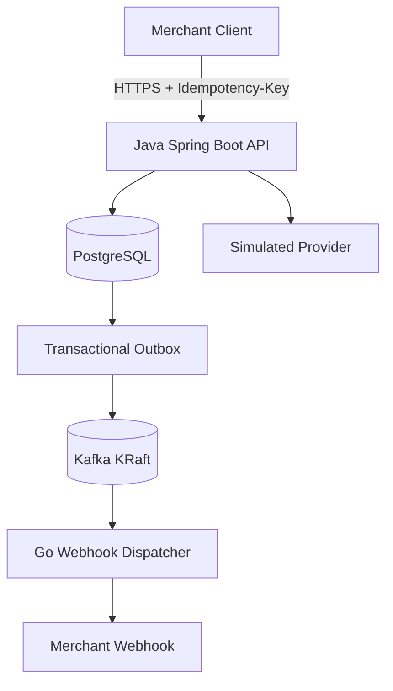

# ReliablePay

**Reliable payment-processing primitives for distributed systems.**

ReliablePay is an open-source reference platform for building payment workflows that remain safe under retries, duplicate requests, process crashes, network failures, and delayed event delivery.

> **Project status:** Foundation phase. This is a learning, portfolio, and open-source engineering project—not a certified payment processor. Do not use it to move real funds.

## Decisions

- Production-oriented engineering scope.
- PostgreSQL is the authoritative system of record.
- Java 21 + Spring Boot owns the payment API and transaction domain.
- Go owns the independently deployable webhook dispatcher.
- Kafka runs in KRaft mode for local development (no ZooKeeper).
- Idempotent replay returns `200 OK`.
- Initial simulated currencies: ETB and USD.
- Delivery is at-least-once; durable idempotency and deduplication provide effectively-once outcomes within defined boundaries.

## Architecture



## Planned capabilities

1. PostgreSQL-backed idempotency and duplicate-request protection.
2. Explicit payment state machine and audit history.
3. Transactional outbox and Kafka event publishing.
4. Go webhook delivery with HMAC signatures, retries, backoff, and dead-letter handling.
5. Docker Compose development environment, integration tests, and CI.

## Repository layout

```text
docs/
  requirements/
  architecture/
  decisions/
java/
  payment-platform/
go/
  webhook-dispatcher/
infrastructure/
examples/
```

## Development principles

- PostgreSQL—not Redis—is the correctness authority for idempotency.
- Never use floating-point values for money; use integer minor units.
- A provider timeout is an ambiguous outcome, not proof of payment failure.
- Use at-least-once delivery and explicit deduplication; do not claim universal exactly-once processing.
- Never commit real credentials, card data, or customer information.

## Roadmap

- [x] Finalize Phase 1 architecture decisions.
- [ ] Publish requirements, architecture, and ADR documentation.
- [ ] Implement Java payment API and PostgreSQL-backed idempotency.
- [ ] Prove concurrent duplicate-request safety with integration tests.
- [ ] Add transactional outbox and Kafka.
- [ ] Implement Go webhook dispatcher.
- [ ] Add observability, security hardening, contributor docs, and releases.

## License

Apache License 2.0 (planned; add the full license text before the first public release).
