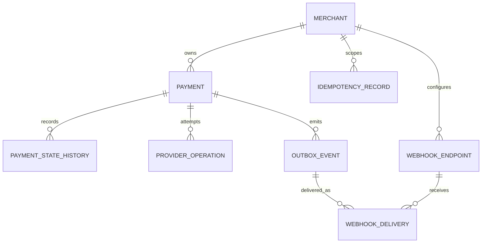

# Database Design

**Database:** PostgreSQL  
**Money representation:** BIGINT minor units  
**Schema changes:** Versioned migrations

## 1. Entity relationships

## 2. Tables

### merchants
- `id UUID PRIMARY KEY`
- `display_name`
- `status` (ACTIVE, SUSPENDED)
- `created_at`, `updated_at`

### payments
- `id UUID PRIMARY KEY`
- `merchant_id UUID NOT NULL REFERENCES merchants(id)`
- `merchant_reference VARCHAR`
- `amount_minor BIGINT NOT NULL CHECK (amount_minor > 0)`
- `currency CHAR(3) NOT NULL`
- `status VARCHAR NOT NULL`
- `version BIGINT NOT NULL DEFAULT 0`
- `provider_reference VARCHAR NULL`
- `created_at`, `updated_at`

Indexes: `(merchant_id, created_at DESC)`; unique provider reference where non-null and provider scope requires it.

### idempotency_records
- `id UUID PRIMARY KEY`
- `merchant_id UUID NOT NULL REFERENCES merchants(id)`
- `operation VARCHAR NOT NULL`
- `idempotency_key VARCHAR NOT NULL`
- `request_hash CHAR(64) NOT NULL`
- `response_status INTEGER NOT NULL`
- `response_body JSONB NOT NULL`
- `payment_id UUID NULL REFERENCES payments(id)`
- `created_at`, `expires_at`

Constraint: `UNIQUE (merchant_id, operation, idempotency_key)`. The initial implementation retains records indefinitely; expiry/cleanup policy must not permit a key to be reused while its payment can still be acted upon. Store a canonical request hash, not raw secrets.

### payment_state_history
- `id UUID PRIMARY KEY`
- `payment_id UUID NOT NULL REFERENCES payments(id)`
- `from_status VARCHAR NULL`
- `to_status VARCHAR NOT NULL`
- `actor_type VARCHAR NOT NULL`
- `reason_code VARCHAR NULL`
- `correlation_id VARCHAR NULL`
- `created_at TIMESTAMPTZ NOT NULL`

Index: `(payment_id, created_at)`. Application permissions should prevent update/delete.

### provider_operations
- `id UUID PRIMARY KEY`
- `payment_id UUID NOT NULL REFERENCES payments(id)`
- `provider_name VARCHAR NOT NULL`
- `provider_idempotency_key VARCHAR NOT NULL`
- `provider_reference VARCHAR NULL`
- `status VARCHAR NOT NULL`
- `last_error_code VARCHAR NULL`
- `created_at`, `updated_at`

Constraint: unique `(provider_name, provider_idempotency_key)`.

### outbox_events
- `id UUID PRIMARY KEY` (stable event ID)
- `aggregate_type VARCHAR NOT NULL`
- `aggregate_id UUID NOT NULL`
- `aggregate_version BIGINT NOT NULL`
- `event_type VARCHAR NOT NULL`
- `payload JSONB NOT NULL`
- `occurred_at TIMESTAMPTZ NOT NULL`
- `published_at TIMESTAMPTZ NULL`
- `attempts INTEGER NOT NULL DEFAULT 0`

Constraint: unique `(aggregate_id, aggregate_version, event_type)` where appropriate. Index unpublished rows by `(occurred_at)` with a partial predicate `published_at IS NULL`.

### webhook_endpoints
- `id UUID PRIMARY KEY`
- `merchant_id UUID NOT NULL REFERENCES merchants(id)`
- `url TEXT NOT NULL`
- `secret_reference VARCHAR NOT NULL`
- `enabled BOOLEAN NOT NULL DEFAULT TRUE`
- `created_at`, `updated_at`

Secrets should be stored in a secret manager or encrypted with envelope encryption; `secret_reference` is not the secret itself.

### webhook_deliveries
- `id UUID PRIMARY KEY`
- `event_id UUID NOT NULL REFERENCES outbox_events(id)`
- `endpoint_id UUID NOT NULL REFERENCES webhook_endpoints(id)`
- `status VARCHAR NOT NULL`
- `attempt_count INTEGER NOT NULL DEFAULT 0`
- `next_attempt_at TIMESTAMPTZ NULL`
- `last_http_status INTEGER NULL`
- `last_error_code VARCHAR NULL`
- `delivered_at TIMESTAMPTZ NULL`
- `created_at`, `updated_at`

Constraint: unique `(event_id, endpoint_id)`.

## 3. Idempotency transaction

The unique constraint is the concurrency authority. Application-level "check then insert" without a unique constraint is unsafe. Insert/claim the key using PostgreSQL conflict handling, then read the winning record. If the key already exists, compare request hashes and return the stored response or 409. The implementation must define how in-progress claims are represented and how a crashed owner is recovered.

## 4. Outbox relay concurrency

Workers should claim rows using a short transaction and `FOR UPDATE SKIP LOCKED`, or use a lease/claim token. Do not hold a database lock while waiting for Kafka. A publish acknowledgement followed by a crash before `published_at` update can duplicate a message; consumers must deduplicate by event ID.

## 5. Migration conventions

- Use ordered, immutable migration files.
- Never edit a migration already applied in a shared environment; add a corrective migration.
- Add constraints and indexes deliberately, considering lock and table size implications.
- Test migrations against an empty database and an upgraded database.
- Keep schema ownership with the service that owns the data.
