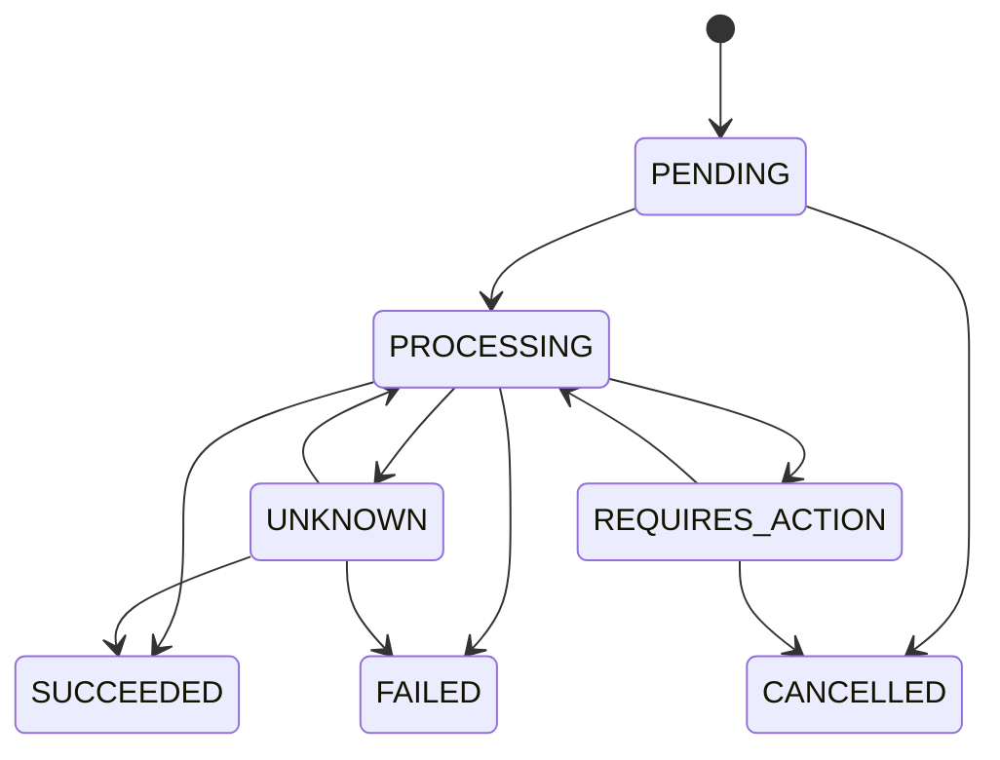

# Payment Lifecycle and State Machine

## 1. Design principles

A payment is a durable business resource, not a single HTTP request. Request acceptance, provider processing, and final outcome may happen at different times. A network timeout is an unknown outcome until reconciled.

## 2. States

| State | Meaning | Terminal? |
|---|---|---|
| PENDING | Payment intent is durably accepted; processing has not reached a known outcome | No |
| PROCESSING | A provider operation is in progress | No |
| REQUIRES_ACTION | Additional customer/merchant action is required (reserved for future flows) | No |
| SUCCEEDED | Provider reports successful completion | Yes |
| FAILED | Provider reports a definitive failure/decline | Yes |
| CANCELLED | Payment was cancelled before irreversible completion | Yes |
| UNKNOWN | Outcome cannot currently be determined; reconciliation is required | No |

## 3. Allowed transitions

Transitions not shown are rejected. Terminal states cannot be reopened. If a provider later reports contradictory information, record an operational incident and reconciliation fact rather than silently rewriting history.

## 4. State semantics

- **PENDING:** The payment intent and idempotency claim are committed. It is safe to return a payment resource to the merchant.
- **PROCESSING:** A provider operation has been initiated using a stable provider idempotency/reference key.
- **UNKNOWN:** The provider may have processed the operation, but ReliablePay lacks a definitive response. Do not retry with a new provider key.
- **SUCCEEDED / FAILED:** Definitive provider outcome has been recorded.
- **CANCELLED:** Cancellation is only legal while the operation is known not to have completed.

## 5. API semantics

- First accepted create request: `201 Created` with payment ID and current state.
- Identical idempotent replay: `200 OK` with the original response body and payment ID.
- Same key, different canonical request: `409 Conflict`.
- Invalid request: `400 Bad Request`.
- Unauthenticated/unauthorized merchant: `401` / `403`.
- Unknown payment or payment outside merchant scope: use a consistent non-disclosing `404` policy.
- A payment that is still processing is represented as a resource state; do not hold the HTTP request open until every downstream webhook is delivered.

## 6. Transition transaction

Each accepted transition shall execute in one database transaction:
1. Lock or compare-and-set the payment row using its current version.
2. Validate the transition against the state machine.
3. Update state and increment the optimistic version.
4. Insert an immutable payment-state-history row.
5. Insert the corresponding outbox event with a stable event ID.
6. Commit.

If any step fails, none of the transition's writes may commit.

## 7. Provider operation recovery

1. Persist a provider-operation record and stable provider idempotency key before dispatch.
2. Call the provider outside the database transaction.
3. Persist the definitive response in a new transaction.
4. On timeout, persist UNKNOWN and enqueue reconciliation work.
5. Reconcile using the same provider reference/key; do not create a second provider operation.
6. Escalate unresolved operations for operator review.

The simulated provider must expose deterministic modes for success, decline, slow response, timeout-before-processing, and timeout-after-processing to exercise ambiguous outcomes.

## 8. Audit requirements

Every state change records payment ID, previous state, new state, actor/type, reason/code, timestamp, correlation ID, and optional provider reference. Audit rows are append-only to application roles. Sensitive values and raw secrets must never be recorded.
