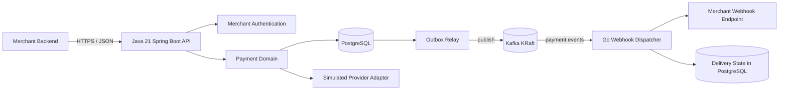
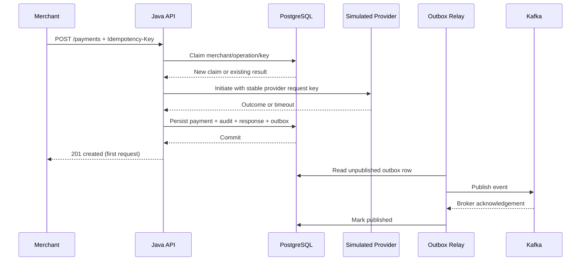

# System Architecture

**Status:** Baseline architecture  
**Primary consistency boundary:** PostgreSQL transaction in the Java payment service

## 1. Context

ReliablePay accepts merchant payment intents and orchestrates a simulated provider operation. PostgreSQL is authoritative for payment state. Kafka transports committed domain events; it is not the source of truth. The Go service delivers events to merchant webhook endpoints.

## 2. Component view

## 3. Responsibilities

### Java payment platform
- Owns merchant-scoped payment commands and queries.
- Validates input and currency/amount rules.
- Enforces idempotency and state transitions.
- Coordinates provider calls without holding database transactions open across slow network calls.
- Writes payment, idempotency response, audit history, and outbox records transactionally.
- Exposes versioned REST endpoints and health checks.

### PostgreSQL
- Authoritative store for payments, idempotency records, state history, outbox events, and webhook delivery state (where shared database deployment is selected).
- Enforces uniqueness and referential integrity.
- Uses migrations as the schema change mechanism.

### Kafka (KRaft)
- Carries durable event messages from the outbox relay to the dispatcher.
- Uses a stable event ID and payment ID as the event key where ordering by payment is required.
- Assumes at-least-once publication and consumption.
- Uses replication settings appropriate to the deployment; a single-node local broker is not highly available.

### Go webhook dispatcher
- Consumes payment events.
- Resolves merchant webhook configuration from trusted persisted configuration.
- Signs the exact transmitted payload using HMAC-SHA256.
- Persists delivery attempts and schedules retries with exponential backoff and jitter.
- Stops after the configured attempt/time budget and records a dead-letter outcome.
- Uses event ID for deduplication and safe redelivery.

### Simulated provider
- Provides deterministic outcomes for success, decline, and timeout tests.
- Is an adapter boundary, not a real bank or payment gateway.
- Must support a stable provider reference and idempotency simulation.

## 4. Payment creation sequence

The implementation must refine the sequence for asynchronous/ambiguous provider outcomes. In particular, do not keep a database transaction open while calling a remote provider. The durable payment intent and operation state must make recovery possible if the process exits between steps.

## 5. Consistency and delivery guarantees

| Boundary | Guarantee |
|---|---|
| Merchant request → payment | At most one result for a scoped idempotency key |
| Payment + audit + outbox | Atomic PostgreSQL transaction |
| Outbox → Kafka | At-least-once; duplicates possible |
| Kafka → dispatcher | At-least-once consumer semantics |
| Dispatcher → merchant | At-least-once; merchant must deduplicate event ID |
| Whole distributed workflow | No global exactly-once guarantee |

A Kafka acknowledgement followed by a crash before marking the outbox row published can cause a duplicate. This is expected. Stable event IDs make duplicates identifiable.

## 6. Data ownership

The Java service owns payment and payment-event facts. The dispatcher owns delivery-attempt lifecycle. The merchant owns its own downstream business effects and must deduplicate webhook events. Services must not update another service's domain tables directly; use APIs or events for cross-service changes.

## 7. Failure handling

- PostgreSQL unavailable: fail closed; do not report a payment as accepted without durable commit.
- Kafka unavailable: continue committing outbox rows; relay retries later.
- Dispatcher unavailable: Kafka retains events within configured retention; restart resumes consumption.
- Merchant endpoint unavailable: retry with bounded exponential backoff and jitter.
- Provider timeout: retain an ambiguous/in-progress state and reconcile; never assume decline.
- Poison event: quarantine/dead-letter with alerting; do not silently discard.

## 8. Security boundaries

- Authenticate each merchant and authorize every payment read/write by merchant ID.
- Store only webhook secret material needed for HMAC; protect it at rest and never log it.
- Validate webhook URLs and defend against SSRF: allow HTTPS, block loopback/private/link-local/reserved IP ranges, revalidate DNS on connection, and restrict redirects.
- Apply request size limits, rate limits, connect/read timeouts, and outbound egress controls.
- Do not collect cardholder data in this reference implementation.
- Keep credentials out of Git; use local ignored environment files and documented examples.

## 9. Deployment topology

Local development uses Docker Compose with PostgreSQL and a single-node Kafka KRaft broker. Java and Go can run locally or in containers. A production-like deployment would require managed/high-availability PostgreSQL, multi-broker Kafka, secret management, TLS, network policies, backups, monitoring, and tested disaster recovery. Compose is not a production deployment architecture.

## 10. Open implementation decisions

- Whether the outbox relay is embedded in the Java service or separately deployed.
- Whether dispatcher delivery state shares PostgreSQL initially or uses a dedicated database.
- Exact provider-operation recovery protocol and reconciliation schedule.
- Kafka topic partition count, retention, replication, and consumer concurrency.
- Merchant authentication mechanism and credential rotation model.
